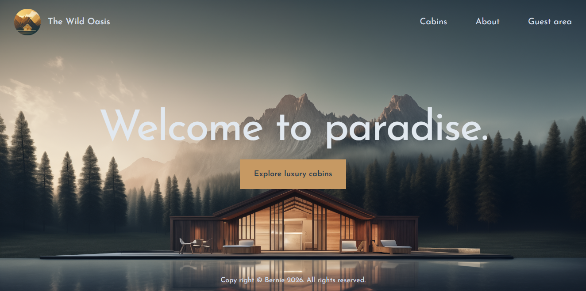

# The Wild Oasis Website

This is a fullstack website developed through a code-along course project with Jonas Schmedtmann from his ultimate react course on Udemy.

## Table of contents

- [Overview](#overview)
  - [Screenshot](#screenshot)
  - [Links](#links)
- [My process](#my-process)
  - [Built with](#built-with)
  - [What I learned](#what-i-learned)
  - [Continued development](#continued-development)
  - [Useful resources](#useful-resources)
- [Author](#author)

## Overview

### Users should be able to

- **Navigate** through the website **seamlessly**.
- Create account, **login** & **logout**.
- See all the **available cabins** and be able to **reserve** a cabin.
- See all their **reserved cabins**.
- **Delete or edit** a reserved cabin.
- **Edit** their **account information**.

### Screenshot

### Links

- Solution URL: [Github](https://github.com/SoftPillow20/The-Wild-Oasis-Website)
- Live Site URL: [https://the-wild-oasis-website-softpillow20s-projects.vercel.app](https://the-wild-oasis-website-softpillow20s-projects.vercel.app)

## My process

### Built with

- [Nextjs16](https://nextjs.org/docs)
- [TailwindCSSv4](https://tailwindcss.com/docs/installation/using-vite)
- [React18](https://reactjs.org/) - JS library

### What I learned

- **Nextjs fundamentals and important concepts:** I've learned a lot of things when I created this website using this meta-framework. Jonas has taught me the fundamentals and important concepts such as:
  - **Automatic routing**: One of the useful approach when using Nextjs is its ability to automatically detect router through the file directory structure. So, for each pages folder, a page component can be made to write code specific to that route. Additionally, Nextjs also have their own component for navigating to these routes called Link (this is similar to react router's Link component).

  - **React Server Component:** In Nextjs, we can write our code in a server component (SC) or in a client component (CC). Nextjs' default component is a SC, but by using "use client" we make this component to a CC. However, we cannot just make a component into a CC specially if this component fetches data, or is dynamically rendered. There are many ways where we can make a SC into CC and one of a great example of this is to move the fetching processing from the SC to its parent component and then pass those data to a props. That way, we can make the SC a CC.

  - **RSC and SSR**: These two are completely different, BUT they do interact with each other. One important thing about these two is that both the client and the server renders at the same time on the server when SSR is enabled.

  - **Streaming Route and React Suspense** - streaming is automatically enabled once we add load.js component in any of our route/file directory (once streaming is enabled, Javascript must not be disabled as disabling this will cause for the website to not work). Now, adding suspense to a streaming route/component makes the user see the content sooner instead of blank/static screen. One example of this concept is in the website itself (cabins page) where the texts are loaded immediately while the cabin lists are still rendering/waiting to be rendered.

  - **Static Site Generation (SSG)** - In Nextjs, there is a way of developing a static website even with a dynamic route, as long as these routes are finite and are preloaded inside the export named function called generateStaticParams. Other ways we can make our components static is by using the "use client" directive.

  - **Caching** - In Nextjs16, caching has been changed from "on by default" to "uncached by default" which makes fetched or computed data dynamic and loaded at request time.

### Continued development

- Currently making this website to be responsive for mobile screens.

## Author

- Github - [@SoftPillow20](https://github.com/SoftPillow20)
